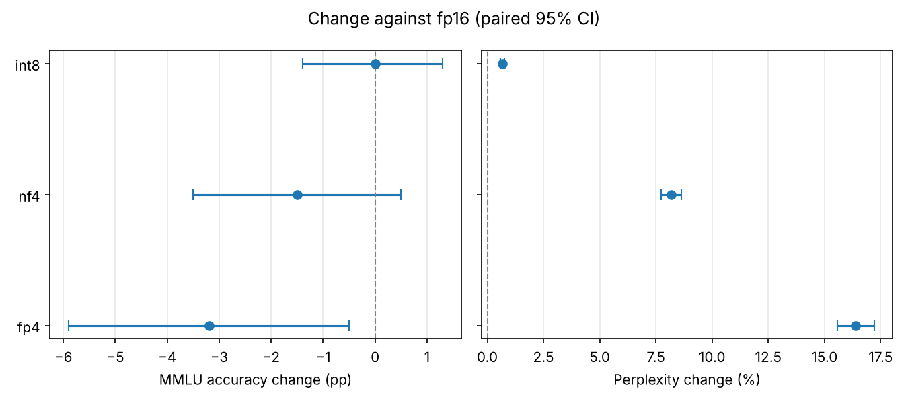

# How much does quantization really cost?

A small, reproducible benchmark of post training quantization for an open LLM.
It compares the same model in 16 bit, 8 bit and 4 bit precision and asks two questions:

1. **What do we gain?** Memory footprint, decode throughput and prefill throughput.
2. **What do we lose, and is the loss real?** Perplexity and MMLU accuracy, with
   paired bootstrap confidence intervals and an exact McNemar test, so a small drop
   in accuracy is not mistaken for a real one (or the other way round).

Most quick quantization comparisons report a single accuracy number per variant.
With a few hundred questions, differences of one or two points are often within noise,
so this project evaluates every variant on exactly the same questions and text windows
and compares them pairwise.

## Variants

| Variant | Method | Measured |
|---|---|---|
| `fp16` | 16 bit floats (baseline) | accuracy, memory, speed |
| `int8` | bitsandbytes LLM.int8 | accuracy, memory, speed |
| `nf4` | bitsandbytes 4 bit NormalFloat | accuracy, memory, speed |
| `fp4` | bitsandbytes 4 bit float | accuracy, memory, speed |
| `mo_int8_sq` | NVIDIA Model Optimizer, INT8 SmoothQuant | accuracy only (simulated) |
| `mo_int4_awq` | NVIDIA Model Optimizer, INT4 AWQ | accuracy only (simulated) |

The Model Optimizer variants use simulated quantization in PyTorch (quantize and
dequantize), which gives a realistic estimate of accuracy. Their speed and memory
benefits only appear once the model is exported to an inference engine such as
TensorRT-LLM, so those numbers are not reported here.

## Metrics

- **Memory**: model footprint and peak GPU memory during generation.
- **Speed**: decode throughput (batch size 1, greedy, 128 new tokens) and prefill
  throughput (one forward pass over 1024 tokens), averaged over 5 runs after warmup.
- **Perplexity** on the WikiText-2 test set, split into non overlapping windows of
  1024 tokens. Keeping the loss of each window lets us bootstrap the perplexity ratio.
- **MMLU** zero shot accuracy on a fixed random subset of 1000 test questions, scored
  by comparing the logits of the answer letters.

## Statistics

- Accuracy change: paired bootstrap over questions (10,000 resamples, 95% CI).
- Exact McNemar test on the questions where baseline and quantized model disagree.
- Perplexity change: paired bootstrap over text windows.

## Run it (Google Colab or Kaggle, free T4 GPU)

```bash
pip install -r requirements.txt
python run_benchmark.py --variant fp16
python run_benchmark.py --variant int8
python run_benchmark.py --variant nf4
python run_benchmark.py --variant fp4
python analyze.py --baseline fp16
```

Optional, with `pip install nvidia-modelopt`:

```bash
python run_benchmark.py --variant mo_int8_sq
python run_benchmark.py --variant mo_int4_awq
```

Default model: `Qwen/Qwen2.5-1.5B` (change it with `--model`). Each run saves a JSON
file with the raw, per item results in `results/`, and `analyze.py` writes
`results/summary.md` plus two plots: accuracy versus memory and accuracy versus speed.

## Results

`Qwen/Qwen2.5-1.5B` on an NVIDIA Tesla T4 (Kaggle), PyTorch 2.11, Transformers 5.20.
1000 MMLU questions and 80 WikiText-2 windows of 1024 tokens, identical for every variant.

| Variant | Memory (GB) | Decode (tok/s) | Prefill (tok/s) | Perplexity | PPL change [95% CI] | MMLU acc [95% CI] | Acc change [95% CI] | McNemar p |
|---|---|---|---|---|---|---|---|---|
| fp16 | 2.88 | 25.9 | 3788 | 9.738 | baseline | 59.2% [56.2, 62.2] | baseline | |
| int8 | 1.66 | 4.9 | 1565 | 9.803 | +0.67% [+0.57%, +0.77%] | 59.2% [56.1, 62.2] | +0.0 pp [-1.4, +1.3] | 1.000 |
| nf4 | 1.05 | 16.6 | 1901 | 10.534 | +8.17% [+7.73%, +8.63%] | 57.7% [54.6, 60.7] | -1.5 pp [-3.5, +0.5] | 0.180 |
| fp4 | 1.05 | 16.8 | 1949 | 11.332 | +16.37% [+15.58%, +17.21%] | 56.0% [52.9, 59.1] | -3.2 pp [-5.9, -0.5] | 0.026 |



### What the numbers say

**1. Memory goes down, speed does not go up (on this setup).** 8 bit saves 42% of the
memory and 4 bit saves 64%, but every quantized variant is slower than fp16 at batch
size 1: 4 bit decodes at about 65% of the fp16 speed and LLM.int8 at only 19%. A 1.5B
model in fp16 already fits comfortably on a T4, and bitsandbytes dequantizes weights on
the fly, so here quantization buys memory, not latency. Real speedups need fused low
precision kernels (TensorRT-LLM, vLLM) and usually larger models or batches.

**2. A single accuracy number hides a lot of churn.** INT8 has exactly the same MMLU
accuracy as fp16, but 48 of the 1000 answers change: 24 go from right to wrong and 24
from wrong to right. For NF4, 109 answers flip, and for FP4, 194. Aggregate accuracy
can look identical while the model behaves differently on individual questions.

**3. Perplexity sees damage that MMLU cannot confirm.** NF4 is worse than fp16 on all 80
text windows (+8.2% perplexity, clearly significant), yet its 1.5 point MMLU drop is not
significant with 1000 questions (p = 0.18). With the observed variability, detecting a
1.5 point drop with 80% power would need roughly 3,800 questions. Small accuracy
benchmarks can easily report "no loss" when there is one.

**4. The 4 bit format matters as much as the bit width.** NF4 and FP4 use exactly the
same memory, but NF4 roughly halves the damage: perplexity +8.2% versus +16.4%
(FP4 is 7.6% [7.0, 8.2] worse than NF4 in a direct paired comparison), and only the FP4
accuracy drop is statistically significant. NF4's levels are designed for the roughly
normal distribution of trained weights, and it shows.

**In short:** INT8 is close to lossless but slow with these kernels, NF4 is the sensible
choice when memory is the constraint, and FP4 should be avoided when NF4 is available.

## Limitations

- Speed is measured with Hugging Face `generate` at batch size 1. Production engines
  (TensorRT-LLM, vLLM) and larger batches can change the picture a lot, especially
  for bitsandbytes, whose kernels favour memory savings over speed.
- A T4 has no native support for FP8 or bfloat16, so those formats are not compared.
- 1000 MMLU questions keep runs short on a free GPU; the confidence intervals show
  how much that matters.
